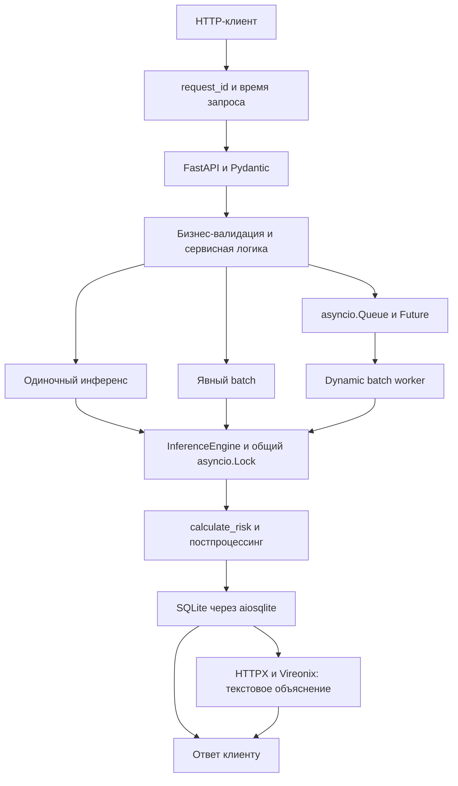

# Лабораторная работа № 2 - развитие AI-сервиса

Асинхронный сервис агроскоринга на FastAPI с пакетным инференсом, очередью запросов,
постоянным хранением в SQLite и интеграцией с внешней языковой моделью.
Исходный код, тесты и зависимости находятся в каталоге `lab2/`.

## Структура

```text
lab2/
├── __init__.py
├── main.py             # приложение, lifespan, middleware, ошибки и REST endpoints
├── config.py           # параметры модели, БД, очереди и LLM
├── schemas.py          # Pydantic-схемы входов, результатов, ошибок и пагинации
├── model.py            # calculate_risk и асинхронный inference engine
├── services.py         # бизнес-валидация, постпроцессинг и сценарии обработки
├── database.py         # асинхронные SQL-запросы и транзакции SQLite
├── batching.py         # ограниченная очередь, Future и dynamic batch worker
├── llm.py              # HTTP-клиент Vireonix и формирование запроса к LLM
├── requirements.txt
├── .gitignore
├── README.md
├── tests/
│   ├── __init__.py
│   ├── support.py
│   ├── test_api.py
│   ├── test_batching.py
│   ├── test_llm.py
│   ├── test_uvicorn.py
│   ├── live_llm.py       # отдельная проверка настоящего провайдера
│   └── check_swagger.cjs # проверка интерфейса Swagger в браузере
├── checks/              # локальные результаты проверок (не включаются в Git)
├── .venv/               # локальное виртуальное окружение
└── agro_scoring.db      # создаётся при запуске, не включается в Git
```

## Установка и запуск

Команды для PowerShell из корня репозитория:

```powershell
python -m venv lab2/.venv
& '.\lab2\.venv\Scripts\python.exe' -m pip install -r lab2/requirements.txt
& '.\lab2\.venv\Scripts\python.exe' -m uvicorn lab2.main:app --host 127.0.0.1 --port 8002 --reload
```

При повторном запуске создание виртуального окружения и установку зависимостей
можно пропустить. Альтернативный запуск - `python -m lab2.main` из корня репозитория
при использовании интерпретатора `lab2/.venv/Scripts/python.exe`.

- Swagger: <http://127.0.0.1:8002/docs>.
- OpenAPI: <http://127.0.0.1:8002/openapi.json>.
- Проверка API: <http://127.0.0.1:8002/health>.

Версии библиотек при проверке: Python 3.12.3, FastAPI 0.142.2, Pydantic 2.13.5,
Uvicorn 0.54.0, aiosqlite 0.22.1, HTTPX 0.28.1. `pip check` завершился без конфликтов.

Путь к БД определяется относительно `config.py`, а не текущего рабочего каталога:
`lab2/agro_scoring.db`. Параметры находятся в `Settings` в `config.py`.

## Архитектура и обработка запроса



При старте `lifespan` создаёт таблицу, включает WAL, создаёт один inference engine,
ограниченную очередь и worker, открывает переиспользуемый `httpx.AsyncClient`.
При завершении worker отменяется, ожидающие Future завершаются, HTTP-клиент закрывается.
Эти ресурсы создаются для конкретного экземпляра приложения и его event loop.

### Сквозной request_id и middleware

Каждый HTTP-запрос получает идентификатор из `X-Request-ID`; если заголовок отсутствует
или пуст, создаётся UUID4. Идентификатор записывается в `request.state.request_id`,
возвращается в `X-Request-ID`, проходит в логи, результат инференса и SQLite.
В ошибках он находится в JSON-поле `request_id`. `X-Process-Time` содержит время запроса
в секундах. Необработанные исключения дают безопасный JSON с кодом 500; стек остаётся в логе.

Если клиент повторно использует один идентификатор, создаётся новая запись с тем же
`request_id`. Это идентификатор трассировки, а не механизм идемпотентности.

### Скоринг

`FarmRequest` содержит те же девять обязательных полей, что и первая работа:
`farm_id`, `region`, `crop_type`, `area_ha`, `temperature_avg`, `precipitation_mm`,
`payment_delay_days`, `previous_defaults`, `debt`.
Строки непустые; площадь строго положительна; температура от −60 до 60 включительно;
осадки, дни просрочки, число дефолтов и долг неотрицательны.
Допустимые регионы: `Krasnodar`, `Rostov`, `Stavropol`.

Расчёт: базовые 0.1; +0.3 за просрочку свыше 30 дней; +0.3 при наличии дефолтов;
+0.2 при долге свыше 5 000 000; +0.1 при осадках менее 100 мм.
Оценка ограничивается значением 1.0 и округляется до двух знаков.
Категории: `<0.3` - `low`, `<0.7` - `medium`, иначе `high`.
Рекомендации для каждой категории риска формируются в `services.py`.

Пример для `/predict`, `/predict-queued` и `/predict-with-llm`:

```json
{
  "farm_id": "FARM-001",
  "region": "Krasnodar",
  "crop_type": "wheat",
  "area_ha": 2500,
  "temperature_avg": 24.3,
  "precipitation_mm": 320,
  "payment_delay_days": 45,
  "previous_defaults": 1,
  "debt": 6500000
}
```

Результат этого примера: `risk_score=0.9`, `risk_level=high`,
`recommendation="Высокий риск. Требуется ручное рассмотрение"`.
`model_ready=False` отключает все четыре endpoints инференса с HTTP 503.

### SQLite и чтение результатов

Таблица `predictions`: `id`, `request_id`, `farm_id`, `risk_score`, `risk_level`,
`recommendation`, `model_version`, `source`, `created_at`.
Индексы созданы по `request_id` и `risk_level`; `request_id` не уникален из-за batch.
`source`: `single`, `batch`, `queued`, `single+llm`, `seed`.

`POST /predict` возвращает 200 только после `commit`. Явный batch сохраняется одним
`executemany` и одним `commit`; при ошибке транзакция откатывается целиком.
Операции БД используют отдельные асинхронные соединения, параметризованный SQL
и `busy_timeout=5000` мс. Сбой чтения или записи превращается в HTTP 503.
История сортируется по `id DESC`: сначала возвращаются новые записи.

`GET /predictions/{request_id}` возвращает один результат, 404 при отсутствии и 409,
если найдено несколько записей. Полный список для одного запроса доступен через
`GET /requests/{request_id}/predictions`.

### Пагинация

`GET /predictions/by-weekday?weekday=monday&page=1&per_page=5` использует
`strftime('%w', created_at)`, `LIMIT/OFFSET` и `COUNT(*)`. Подсчёт и выборка выполняются
в одной транзакции чтения, чтобы видеть согласованный снимок.
`weekday` обязателен и нечувствителен к регистру; `page≥1`; `1≤per_page≤100`.
Метаинформация содержит общее число записей и страниц и ссылки `next_page` / `prev_page`.
Для пустой выборки первая страница возвращает 200 и пустой список, последующие - 404.

Вспомогательный `POST /demo/seed-weekdays?count=70` создаёт тестовые записи
за последние 21 день для проверки фильтрации по дням недели.

### Batching, очередь и таймаут

| Параметр | Значение по умолчанию |
|---|---:|
| Максимальный batch | 8 |
| Окно накопления dynamic batch | 50 мс |
| Максимальная длина очереди | 100 |
| Таймаут инференса | 2 с |
| Имитация фиксированных затрат вызова | 20 мс |
| Имитация затрат на один объект | 3 мс |
| Таймаут внешнего LLM API | 60 с |

`/batch-predict` принимает `{"items": [...]}` с 1-8 хозяйствами и вызывает
`model_predict_batch` один раз. Ответ содержит общий `request_id`, `batch_size`,
`processing_time_ms` и `items`.

`/predict-queued` принимает одно хозяйство. Worker забирает первый запрос, ждёт
наполнения до восьми элементов или истечения 50 мс, вызывает batch-модель и направляет
каждому запросу его score через отдельный Future. Каждый HTTP-запрос затем сохраняет
свой результат с собственным `request_id`. Завершённые и отменённые Future пропускаются.
На каждый извлечённый элемент вызывается `task_done`.

При заполнении очереди запрос получает 429 и `Retry-After: 1`, а не ожидает свободного
места. `asyncio.wait_for` ограничивает инференс; для очереди лимит включает ожидание
формирования batch, нахождение в очереди и вычисление результата. Таймаут даёт 504.
Время записи в SQLite и LLM-вызова не входит в двухсекундный лимит инференса.

### LLM

Настоящий endpoint: `POST https://vireonix.ai/v1/chat/completions`, модель `auto`,
без API-ключа и Authorization. В приложении отсутствуют mock-режим и автоматическая
замена ответа. Заглушки применяются только в `tests/test_llm.py` через MockTransport.

`/llm/chat` принимает `prompt` длиной 1-5000, `model` (по умолчанию `auto`),
`temperature` от 0 до 2 и `max_tokens` от 1 до 2000 (по умолчанию 300).
Возвращает запрошенную и фактическую модель, текст, reasoning при наличии,
finish_reason, usage и latency_ms.

`/predict-with-llm` сначала вычисляет и фиксирует прогноз, затем просит LLM объяснить
готовые `risk_score`, `risk_level`, рекомендацию и версию. `farm_id` и исходные
финансовые признаки во внешний LLM API не передаются. Ответ LLM не участвует в скоринге.
Если LLM не ответила, клиент получает ошибку, но записанный прогноз остаётся доступен
по `request_id`. Внешний HTTP-код, отличный от 200, или некорректный ответ дают 502;
сетевая ошибка - 503, таймаут - 504.

## API-контракт

Все успешные ответы используют HTTP 200. Во всех JSON-ошибках присутствует `request_id`.
Необработанная внутренняя ошибка для любого endpoint даёт 500.

| Endpoint | Метод | Вход | Ответ | Ожидаемые ошибки помимо 500 |
|---|---|---|---|---|
| `/health` | GET | - | HealthResponse | - |
| `/model-info` | GET | - | ModelInfoResponse | - |
| `/predict` | POST | FarmRequest | PredictionResponse | 400, 422, 503, 504 |
| `/batch-predict` | POST | BatchRequest | BatchPredictionResponse | 400, 422, 503, 504 |
| `/predict-queued` | POST | FarmRequest | PredictionResponse | 400, 422, 429, 503, 504 |
| `/queue-status` | GET | - | QueueStatusResponse | - |
| `/predictions` | GET | limit=10 (1…100), risk_level | список PredictionResponse | 400, 422, 503 |
| `/predictions/by-weekday` | GET | weekday, page=1, per_page=5 | PaginatedPredictionsResponse | 400, 404, 422, 503 |
| `/predictions/{request_id}` | GET | path request_id | PredictionResponse | 404, 409, 422, 503 |
| `/requests/{request_id}/predictions` | GET | path request_id | список PredictionResponse | 404, 422, 503 |
| `/llm/chat` | POST | LLMChatRequest | LLMChatResponse | 422, 502, 503, 504 |
| `/predict-with-llm` | POST | FarmRequest | PredictWithLLMResponse | 400, 422, 502, 503, 504 |
| `/demo/seed-weekdays` | POST | count=70 (7…1000) | SeedResponse | 422, 503 |
| `/` | GET | - | ссылки на docs и health | - |

## Тестирование

Автоматические тесты не требуют доступности внешнего LLM API:

```powershell
& '.\lab2\.venv\Scripts\python.exe' -m unittest discover -s lab2/tests -t . -v
```

Результат выполнения тестового набора: **35 тестов, OK**.
Локальный протокол сохранён в `lab2/checks/test-results.txt` (не включается в Git).
32 проверки работают через ASGI с настоящей SQLite, очередью и моделью; ещё 3 теста
поднимают отдельные процессы Uvicorn и обращаются к ним по TCP/HTTP. В тестах алгоритм
также сравнивается с функцией первой работы для всех 16 комбинаций пороговых условий,
без импорта или изменения модулей первой работы.

| Проверка | Ожидалось | Получено | Результат |
|---|---:|---:|---|
| GET /health и /model-info | 200 | 200 | OK |
| POST /predict, корректные данные | 200 | 200 | Риск 0.9, high, запись БД |
| area_ha=-100, неверные типы, пропущенные поля | 422 | 422 | request_id сохранён в ошибке |
| Неизвестный регион | 400 | 400 | Запись не создаётся |
| Существующий request_id | 200 | 200 | Прогноз совпадает с сохранённым |
| Неизвестный request_id | 404 | 404 | OK |
| GET /predictions?limit=2 и risk_level=high | 200 | 200 | LIMIT, фильтр, новые первыми |
| limit=-5 | 422 | 422 | OK |
| Корректный POST /batch-predict | 200 | 200 | Один вызов модели и общий ID |
| Пустой batch / batch из 9 объектов | 422 | 422 | OK |
| Одиночное чтение batch request_id | 409 | 409 | Все строки доступны через /requests/... |
| POST /predict-queued | 200 | 200 | Future получает результат своего хозяйства |
| Переполненная очередь | 429 | 429 | Retry-After: 1 |
| GET /queue-status | 200 | 200 | Значения параметров совпадают с ТЗ |
| Пагинация по дню недели | 200 | 200 | Данные, COUNT, ссылки на страницы |
| page=-1 | 422 | 422 | OK |
| Неизвестный weekday | 400 | 400 | OK |
| Несуществующая страница | 404 | 404 | OK |
| Модель не готова | 503 | 503 | Проверены все четыре режима инференса |
| Таймаут инференса 0.001 с | 504 | 504 | Проверен в ASGI и настоящем Uvicorn |
| Ошибка/блокировка SQLite | 503 | 503 | Нет ложного успешного ответа |
| Ошибка второго INSERT в batch | 503 | 503 | Первый INSERT тоже откатан |
| Необработанное исключение | 500 | 500 | JSON с request_id без стека |
| Прямой LLM-вызов, изолированный тест | 200 | 200 | MockTransport только в тесте |
| Ошибка / невалидный ответ LLM | 502 | 502 | Изолированные проверки |
| Ошибка соединения / таймаут LLM | 503/504 | 503/504 | Изолированные проверки |
| Реальный POST /llm/chat | 200 | 200 | Vireonix ответил «Работает» |
| Реальный POST /predict-with-llm | 200 | 200 | LLM объяснила риск 0.9 / high |
| Реальная ошибка провайдера при предыдущей попытке | 502 | 502 | Ошибка передана клиенту, прогноз остался в БД |
| Перезапуск Uvicorn с той же SQLite | сохранение данных | сохранены | OK |
| Swagger/OpenAPI | 200 | 200 | 14 endpoints, схемы, ошибки |

Нагрузка: в итоговом тесте 160 одновременных HTTP-запросов дали **102 × 200** и
**58 × 429**, без потери соответствия Future и хозяйства. Для воспроизводимого
заполнения очереди только в тестовом экземпляре фиксированное время модели увеличено
до 0.3 с, таймаут - до 15 с. Очередь остаётся на 100 элементов, batch - до 8.
Это проверка backpressure, а не измерение производительности стандартной конфигурации.

### Настоящий LLM API

Отдельная проверка без mock, при уже запущенном приложении:

```powershell
& '.\lab2\.venv\Scripts\python.exe' -m lab2.tests.live_llm
```

Локальный протокол внешних запросов: `lab2/checks/live_llm.json` (не включается в Git).
При успешной доступности провайдера оба endpoints возвращают HTTP 200.
Внешний сервис может временно возвращать ошибки; успешный локальный тест
не гарантирует успешность всех последующих обращений.
Автоматических повторных запросов и подмены ответа при ошибке провайдера нет.

### Swagger и скриншоты

Интерфейс Swagger доступен по адресу <http://127.0.0.1:8002/docs>.
Через `Try it out` / `Execute` можно проверить одиночный прогноз, историю,
пакетную обработку, очередь, пагинацию и взаимодействие с LLM.

Дополнительный браузерный сценарий `tests/check_swagger.cjs` использует
Node.js, Playwright и Microsoft Edge. Снимки экрана и протоколы сохраняются
локально в `lab2/checks/`. Эта папка исключена из Git.

Успех запросов к внешней LLM зависит от доступности провайдера.
При недоступности сервиса фиксируется фактический HTTP-код ошибки.

## Ответы на вопросы и ограничения

- Синхронные `sqlite3.execute` и `commit` внутри async endpoint блокировали бы event loop;
  `aiosqlite` выполняет операции через отдельный поток с асинхронным ожиданием.
- Один `executemany` и один `commit` уменьшают накладные расходы и дают атомарность всего batch.
- Неограниченная очередь накапливала бы запросы, расходовала память и увеличивала latency;
  ограничение и 429 сообщают клиенту о перегрузке.
- Размер batch повышает throughput за счёт общего overhead; окно ожидания ограничивает
  дополнительную задержку при малой нагрузке.
- SQLite использует UTC для `CURRENT_TIMESTAMP`: день недели рассчитывается в UTC
  и может отличаться от локального календарного дня около полуночи.
- Очередь и inference engine находятся в памяти одного процесса. Запуск рассчитан на
  один Uvicorn worker; при остановке процесса очередь не сохраняется, SQLite сохраняется.
- SQLite остаётся БД с одним одновременно выполняемым писателем; WAL и busy_timeout
  уменьшают конфликты, но не устраняют это ограничение.
- LLM генерирует только пояснение; числовая оценка и категория не зависят от её текста.
  При сбое LLM уже сохранённый прогноз можно получить отдельно. Текстовое качество ответа
  не гарантируется алгоритмом скоринга.
- Swagger загружает свои JS/CSS с CDN; для отображения интерфейса нужен доступ к CDN.
- Тесты со сбоями модели и БД используют изолированные экземпляры приложения и временные
  БД внутри `lab2/.test-data`. Они не повреждают рабочую `agro_scoring.db`.

Итоговая архитектура сохраняет понятный REST-контракт и разделяет вычисление риска,
постоянное хранение и необязательное текстовое объяснение внешней моделью.
